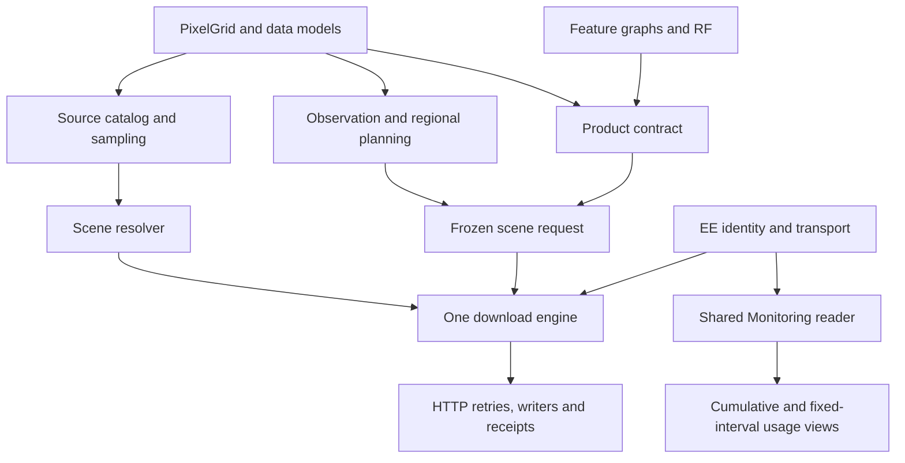

# Architecture and migration

HPGEE 0.2 has one canonical runtime package, organized by capability. Legacy
namespaces exist only in `compat/`, outside `src/`. A legacy leaf module is the
same module object as its canonical target, preserving class identity, stored
callback paths and existing monkeypatch points without duplicating implementations.
The [module map](module-migration.json) records each move.

## Shared execution path

- `core.grid.PixelGrid` is the exact support representation used by generated
  sampling grids, workflow configuration, and raw raster delivery. It preserves
  affine precision, rectangular dimensions and either EE CRS field. Workflow
  requirements such as north-up 30 m UTM remain domain validations.
- `transfer.requests.FrozenSceneRequest` binds already-known scene metadata,
  band order and an exact grid to the existing engine interface. Both observation
  and product adapters use it. Known observations no longer issue a redundant
  metadata enumeration request before transfer. This bypass applies only to
  already-frozen scenes, not open catalog discovery or scientific QA.
- `transfer.engine.DownloadEngine` owns scheduling, retries, writes, receipts,
  and recovery for all transfer paths. Raw blocks use its existing bounded block
  interface; they do not create another download scheduler.
- `workflows.contracts` owns product bands, contract hashing and the collection
  adapter. The product transfer adapter depends on these contracts rather than
  importing the detection runner. `workflows.detection` orchestrates computation
  and delivery through the shared adapter.
- `accounting.metrics.MonitoringReader` provides one REST pager, project/tag
  validation, provider-point identity and overlapping-usage rule. Cumulative
  sampling and fixed-interval computation retain their different report formats
  while sharing the evidence source. Completed and in-progress values are not
  added; absent telemetry stays unknown. Repeated provider points deduplicate,
  and a later query failure preserves evidence from earlier completed queries.
- `runtime.auth.resolve_earth_engine_credentials` uses explicit credentials or
  the current EE identity for monitoring. Importing HPGEE does not authenticate.
  `core.locking.file_lock` is shared by run ledgers and task persistence.

## Boundaries that remain deliberate

Sampling configuration describes sources, selection, concurrency and output.
Workflow configuration describes scientific windows, grids and products. They
retain distinct schemas because combining them would lose domain constraints.
Both reach the same execution primitives. Scientific feature recipes, RF training,
observation plans and raw-series recipes remain explicit functions; harmonization
does not imply they are interchangeable or scientifically validated together.

Existing receipt databases, workload tag prefixes, contract hashes, band order,
scientific masks and original TIFF bytes retain their prior meanings. The source
reorganization does not rewrite research outputs, hot databases, frozen releases,
or old run manifests. Old module execution and console commands remain supported,
while new examples use `hpgee` and capability-based imports.

## Repository and skill ownership

`skills/efficient-gee` is versioned alongside the code so instructions can be pinned
to a release. `tools/install_skill.py` copies only those instruction files to a
separate skill library, and `--check` detects drift. No Git repository is nested
in an installed skill. Shared machine skills such as `slurm-workflow` have their
own installation lifecycle and are not part of HPGEE's runtime distribution.

## Verification

Regression tests cover legacy/canonical module identity, no canonical imports of
legacy packages, offline unified commands, grid round trips, metadata-free frozen
observation delivery through the real engine, immutable callbacks, contract hashes,
resume, project/tag isolation, telemetry deduplication and partial failures.
Wheel and source-distribution installation must also preserve compatibility
packages. Offline verification cannot establish end-to-end cloud throughput,
quota behavior, authentication or scientific acceptance.
